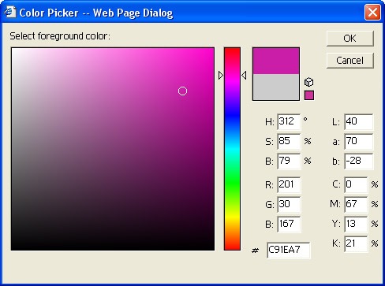

# Lewies Color Picker 1.0

A Photoshop-style color picker for web pages, written in JavaScript in May 2004. Pick a hue from the
vertical strip, then saturation and brightness from the large gradient square. The dialog shows the
same color as HSB, RGB, Lab, CMYK and hex.

*The original 2004 screenshot from the release ZIP (Internet Explorer on Windows XP).*

## Files

| File | What it is |
|---|---|
| `ColorPicker.htm`, `ColorPicker.js`, `ColorPicker.css` | The color picker dialog |
| `Demo.htm` | A page that opens the dialog from a colored box |
| `*.gif`, `Color.cur` | Markers and the picker cursor |

## Browser support

Version 1.0 was built for Internet Explorer 5.5 and later. It opens with `window.showModalDialog` and
draws its gradients with IE's alpha filters, so the gradients don't appear in today's browsers. Version
1.1 added a separate Netscape 7.1 (Mozilla) build that uses PNG gradients instead.

## History

- **1.0**, May 16, 2004 (this tag). Also published to Planet Source Code; a copy is in
  [Lewies-Code-Library-PSC](https://github.com/lewismoten/Lewies-Code-Library-PSC/tree/master/JavaScript/LewiesColorPicker).
- **1.1**, June 26, 2004 (tag `v1.1`).

In January 2006 I ported the HSB/RGB conversion from this picker to LSL for the color panel of my
Particle Lab in Second Life ([3D Color Picker](https://dedricmauriac.wordpress.com/2006/01/28/3d-color-picker/)).

The source files are unchanged from the original release ZIP (`ColorPicker1.0.zip`, attached to the
GitHub release). Commit dates are the newest file dates inside each ZIP.
