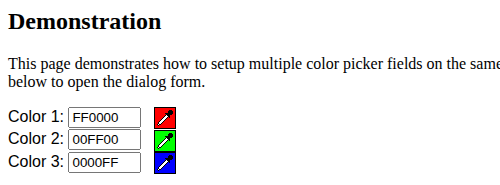
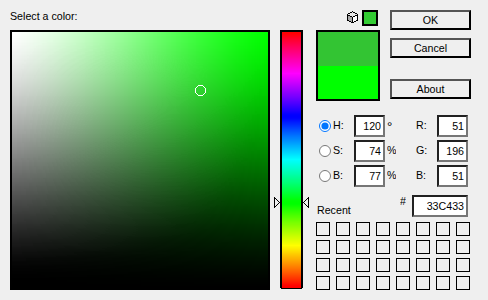
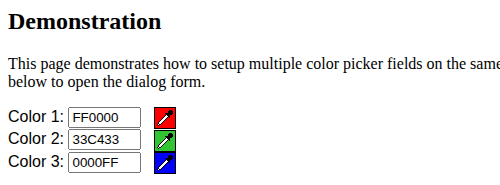
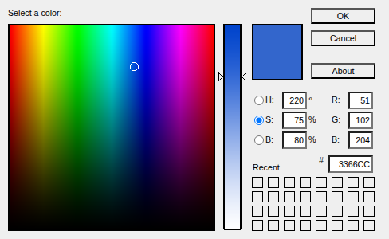
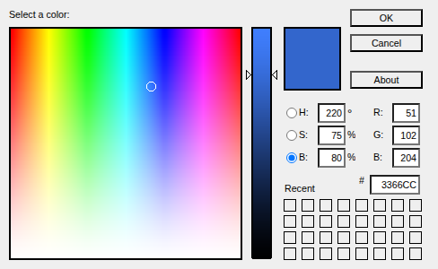

# Lewies Color Picker 1.1

A Photoshop-style color picker for web pages, written in JavaScript in 2004. Click a color field's
eyedropper, then pick a color from the gradient square and the slider, or type it as HSB, RGB or hex.

| 1. Click an eyedropper | 2. Pick a color | 3. Press OK |
|---|---|---|
|  |  |  |

| Saturation on the slider | Brightness on the slider |
|---|---|
|  |  |

*The Netscape 7.1 build running in a current Chromium browser. The picker opens in its own window from
`demo.htm`.*

## What's new in 1.1

- **Two builds:** `IE5.5+/` for Internet Explorer 5.5 and later, and `NS7.1/` for Netscape 7.1 and
  Mozilla browsers. The Netscape build draws its gradients from PNG images instead of IE filters, which
  is why it still works today.
- **Choose the slider channel:** radio buttons put hue, saturation or brightness on the slider. The IE
  build can also use red, green or blue.
- **Recent colors** and an **About** box. A small cube appears when the color isn't web-safe.
- **25 languages**, in `localization/*.xml`, set by the page or detected from the browser.
- **Several color fields on one page:** `demo.htm` has three, each with an eyedropper button.

## Files

| Path | What it is |
|---|---|
| `demo.htm` | Demo page; opens the IE build or the Netscape build |
| `IE5.5+/` | Dialog for Internet Explorer 5.5 and later (`showModalDialog`) |
| `NS7.1/` | Dialog for Netscape 7.1 and Mozilla (`window.open`) |
| `localization/` | Language files |
| `dropper.gif` | Eyedropper icon used on the demo page |
| `readme.txt` | The original readme |

To try it, serve the folder over HTTP (for example `python3 -m http.server`), open `demo.htm` and click
an eyedropper. Allow pop-ups for the page if your browser blocks the picker window.

## Version 1.0

*The original 2004 screenshot of version 1.0 (Internet Explorer on Windows XP). This version also
showed Lab and CMYK values.*

Version 1.0 (May 16, 2004) is at tag [`v1.0`](../../tree/v1.0). It runs only in Internet Explorer: it
opens with `showModalDialog`, which current browsers no longer support, and draws its gradients with IE
filters. A copy is also in
[Lewies-Code-Library-PSC](https://github.com/lewismoten/Lewies-Code-Library-PSC/tree/master/JavaScript/LewiesColorPicker).

## Later use

In January 2006 I ported this picker's HSB/RGB conversion to LSL for the color panel of my Particle Lab in
Second Life ([3D Color Picker](https://dedricmauriac.wordpress.com/2006/01/28/3d-color-picker/)).

## Provenance

The source files in each tag are unchanged from the original release ZIPs, `ColorPicker1.0.zip` and
`ColorPicker1.1.zip`. Both were linked from that 2006 post and hosted on Box, and both are attached to the
GitHub releases. Commit dates are the newest file dates inside each ZIP. The screenshots and this README
were added in 2026.
